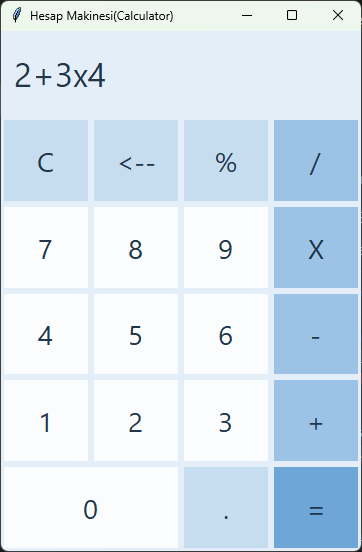

# Hesap Makinesi (Calculator)

[English](#english) | [Türkçe](#türkçe)



---

## English

A button-based calculator built with Python and tkinter. This is my first project, made while learning Python. The code and interface are in Turkish.

### Features

- **Four operations and percent:** `+`, `-`, `x`, `/` and `%` (`50 % 20` → `10`)
- **Operator precedence:** `x`, `/` and `%` are calculated before `+` and `-` (`2 + 3 x 4` → `14`)
- **Negative numbers:** Pressing `-` before a number makes it negative (`-5`, `5 x -3` → `-15`)
- **Decimals:** Only one decimal point per number; pressing `.` on an empty number writes `0.`
- **Backspace (`<--`):** Deletes the last digit; deleting an operator makes the previous number editable again
- **Clear (`C`):** Resets everything
- **Operator replacement:** Pressing two operators in a row keeps the last one
- **Continue from result:** After `=`, pressing an operator continues with the result, pressing a digit starts a new calculation
- **Division by zero:** Shows `Tanımsız` (undefined) instead of crashing
- **Leading zeros:** Inputs like `007` are read as `7`

The calculation does not use `eval`; the operator precedence algorithm is written by hand.

### How to run

Requires Python 3. tkinter comes with Python, nothing else to install.

```
python "Hesap makinesi 2.0.py"
```

---

## Türkçe

Python ve tkinter ile yaptığım butonlu hesap makinesi. Python öğrenirken yaptığım ilk proje.

### Özellikler

- **Dört işlem ve yüzde:** `+`, `-`, `x`, `/` ve `%` (`50 % 20` → `10`)
- **İşlem önceliği:** Önce `x`, `/` ve `%`, sonra `+` ve `-` hesaplanır (`2 + 3 x 4` → `14`)
- **Negatif sayılar:** Sayıdan önce `-`'ye basılırsa sayı negatif olur (`-5`, `5 x -3` → `-15`)
- **Ondalık sayılar:** Bir sayıda yalnızca bir nokta olabilir, boşken noktaya basılırsa `0.` yazılır
- **Sil tuşu (`<--`):** Son rakamı siler; işaret silinince önceki sayı yeniden düzenlenebilir hale gelir
- **Temizle (`C`):** Her şeyi sıfırlar
- **İşaret değiştirme:** Art arda iki işarete basılırsa son basılan geçerli olur
- **Sonuçtan devam:** `=` sonrası işarete basılırsa sonuçla devam edilir, rakama basılırsa yeni işlem başlar
- **Sıfıra bölme kontrolü:** Ekranda `Tanımsız` yazar, program çökmez
- **Baştaki sıfırlar:** `007` gibi girişler `7` olarak alınır

Hesaplama `eval` kullanılmadan, işlem önceliği algoritması elle yazılarak yapılmıştır.

### Çalıştırma

Python 3 gerekir. tkinter Python ile birlikte gelir, ayrıca bir şey kurmaya gerek yoktur.

```
python "Hesap makinesi 2.0.py"
```
